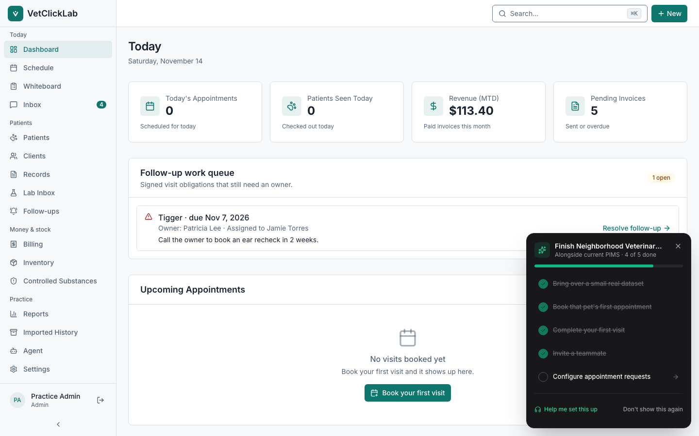
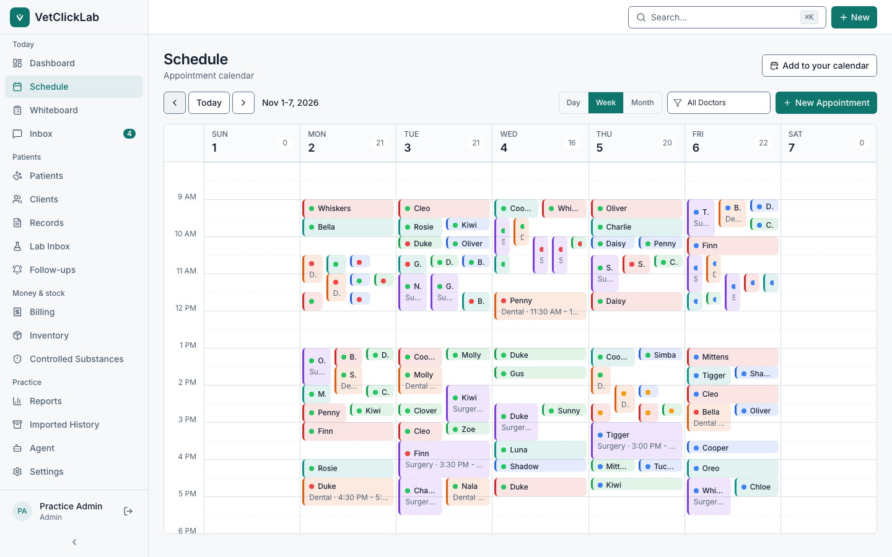
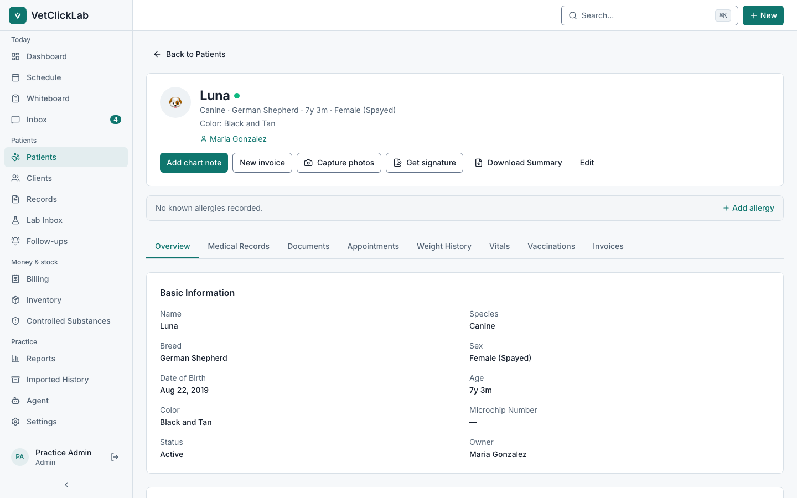

<p align="center">
  
</p>

<h1 align="center">VetClickLab</h1>

<p align="center">
  <strong>Practice management for veterinary clinics: schedule, records, billing and follow-up in one place.</strong>
</p>

<p align="center">
  <a href="https://app.vetclicklab.com">Open the app</a> &middot;
  <a href="https://vetclicklab.com">Website</a> &middot;
  <a href="#features">Features</a> &middot;
  <a href="#run-it-locally">Run it locally</a> &middot;
  <a href="#api">API</a> &middot;
  <a href="#roadmap">Roadmap</a> &middot;
  <a href="#contributing">Contributing</a>
</p>

<p align="center">
  <a href="LICENSE"></a>
</p>

---

## What VetClickLab does

VetClickLab runs the clinic day: the front desk books and checks in, the
clinical team charts and hands off, and checkout turns the visit into an
invoice. Everything a patient needs next, from vaccine recalls to lab
follow-ups, lands in one Follow-ups queue with a named owner.

It is built to be learned in a single shift:

- **Clear by default.** One primary action per screen, plain-language labels,
  and colour reserved for real risk, such as a severe allergy or a critical lab
  value.
- **Safe with clinical data.** Signed records are corrected, never silently
  edited. Every clinic's data is isolated in the database itself, not only in
  application code.
- **Open to integration.** A versioned REST API and signed webhooks let
  booking, reminder, scribe and AI tools read and write supported records.
- **Your data stays yours.** Export everything at any time.

VetClickLab is a hosted service at **[app.vetclicklab.com](https://app.vetclicklab.com)**.
The free trial starts after secure Stripe checkout collects payment details;
there is no charge on the day you sign up.

## Screenshots

<p align="center">
  
</p>

<p align="center">
  
  
</p>

<p align="center"><sub>Rendered from the repository's fictional demo practice. The capture flow lives in <a href="e2e/demo-screenshots.spec.ts">e2e/demo-screenshots.spec.ts</a>.</sub></p>

## Help and guides

- **Staff guides:** step-by-step guides with real screens for the front desk,
  clinical team and practice managers, plus a training path for each role. The
  site lives in [apps/docs](apps/docs); its screenshots come from the demo
  clinic ([how](apps/docs/capture/README.md)).
- **Before live clinic use:** read the
  [Clinic Pilot Readiness Guide](docs/clinic-pilot-readiness.md) for what is
  supported today, what depends on configuration, and what is not yet
  supported.
- **Switching systems:** start with
  [Migrating to VetClickLab](docs/migrating-to-vetclicklab.md).
- **Operations runbooks:** [backups and restore](docs/backup-restore-runbook.md),
  [file recovery](docs/file-object-recovery-runbook.md) and
  [hosted production](docs/hosted-cloud-production.md).

## Features

### Clinic day

**Patients and clients.** Species, breed, weight history with trend charts,
microchips, photos, and allergy alerts that stay at the top of the chart.
Multi-pet households under one client. Search everything with Cmd+K.

**Schedule.** Day, week and month views with a column per doctor,
configurable appointment types, doctor and room conflict detection, recurring
appointments and blocks. Status runs Scheduled → Checked in → In exam →
Checked out, and the calendar follows the practice's time zone.

**Whiteboard.** A shared, auto-refreshing board of who is in the building:
patient, doctor, room, status and time in.

**Medical records.** SOAP notes with rich text, problem lists, vaccinations
with certificates, lab results with reference ranges and trends,
prescriptions with a dosing calculator and refills, and attachments.

**Follow-ups.** One queue for care reminders, vaccine recalls and lab
follow-ups, each with an owner and a due date. Nothing is sent to a client
without a deliberate action and recorded consent.

### Money and stock

**Billing.** Visit closeout keeps the clinical handoff, follow-up plan,
invoice or no-charge decision and checkout together. Treatment templates can populate draft invoices,
with estimates that convert to invoices, tax, payments, balances and revenue
reporting.

**Inventory.** Stock levels, reorder alerts, lots and expiry dates, with
automatic deduction when products are invoiced or prescribed.
Supplier contact management for reorder workflows.

**Controlled substances.** Logs linked to patient and lot, running balances,
waste witnesses and a full audit trail. Validate the configured workflow
against your federal, state and local rules.

### Communication and insight

**Client communication.** Communication history across calls, texts, emails, and inbound portal requests.
Appointment and vaccination reminder workflows are administrator-controlled,
and email delivery requires a configured provider. Hosted SMS and two-way
texting are a controlled, one-location clinic pilot that requires carrier
activation and recorded client consent. General-purpose bulk marketing campaigns are not included.

**Client portal.** Owners view records, request appointments, download
vaccine certificates, see invoices and active prescriptions, and
pay online when Stripe checkout is configured.

**Reports.** KPI cards, revenue trends, appointment utilisation, species mix
and production by doctor, exportable to CSV and PDF.

**Agent.** A built-in assistant that works on practice data through typed
tools (find a patient, summarise history, list overdue vaccines, calculate a
weight-based dose, book an appointment). Every write needs explicit opt-in,
and it stays off until a model provider is configured. Choose the model with
`AI_MODEL`; managed Gemini uses Google Cloud Vertex AI with Vercel OIDC workload identity federation.
Available in the app under **Agent** and via `/api/v1/agent`.

## Tech stack

| Layer            | Technology                                                        |
| ---------------- | ----------------------------------------------------------------- |
| **Frontend**     | Next.js 15 (App Router), TypeScript, React 19                     |
| **UI**           | Radix UI + Tailwind CSS, Inter                                    |
| **API**          | tRPC dashboard API + versioned `/api/v1` REST                     |
| **Database**     | PostgreSQL + Drizzle ORM, row-level security                      |
| **Auth**         | NextAuth.js, role-based access, optional TOTP MFA, recovery codes |
| **Events**       | Signed webhook delivery                                           |
| **Email/SMS**    | Resend + Telnyx SMS (Twilio fallback)                             |
| **Payments**     | Stripe                                                            |
| **File storage** | S3-compatible storage or Vercel Blob (MinIO locally)              |
| **Monorepo**     | Turborepo + pnpm workspaces                                       |
| **Testing**      | Vitest + Playwright                                               |
| **Hosting**      | Vercel                                                            |

## Architecture

```
vpm.vetclicklab/
├── apps/
│   ├── web/                    # Next.js app + API
│   │   ├── app/                # App Router pages
│   │   │   ├── (auth)/         # Sign in, register
│   │   │   ├── (dashboard)/    # Clinic workflows
│   │   │   └── portal/         # Client portal
│   │   ├── components/         # UI components
│   │   ├── lib/                # Utilities and integrations
│   │   └── server/             # tRPC routers and server services
│   └── docs/                   # Staff guide site
├── docs/                       # API, operations and safety guides
├── packages/
│   ├── db/                     # Schema, migrations, RLS, seed data
│   ├── api/                    # Shared Zod validators
│   ├── config/                 # TypeScript and Tailwind config
│   ├── docs-content/           # Guide content
│   └── email/                  # Email templates
├── docker/                     # Local PostgreSQL + MinIO
└── e2e/                        # Playwright tests
```

### Data and security

- **Clinic isolation:** tenant-scoped queries plus PostgreSQL row-level
  security on clinic-owned data ([details](docs/security/row-level-security.md)).
- **Roles:** Admin, Veterinarian, Technician, Front Desk and read-only Viewer,
  enforced at the API layer.
- **Sign-in:** bcrypt passwords, database sessions, optional TOTP MFA,
  recovery codes, per-account lockout and confirmation for privileged actions.
- **Headers:** CSP, HSTS, Permissions-Policy, X-Content-Type-Options,
  X-Frame-Options and Referrer-Policy.
- **Audit:** audit records for security-sensitive clinical and financial
  actions.

Report vulnerabilities privately as described in [SECURITY.md](SECURITY.md).

## Run it locally

For development and evaluation only. Use the fictional seed data, never real
clinic records.

### Prerequisites

- Node.js 24.22.1 or a newer Node.js 24 patch (`nvm use`)
- pnpm 9+
- Docker (for PostgreSQL and MinIO)

### Setup

```bash
git clone https://github.com/vetclicklab-cloud/vpm.vetclicklab.git
cd vpm.vetclicklab

cp .env.example .env
# Replace the placeholder NEXTAUTH_SECRET with a generated one
sed -i.bak "s|^NEXTAUTH_SECRET=.*|NEXTAUTH_SECRET=\"$(openssl rand -base64 32)\"|" .env && rm .env.bak

# Local PostgreSQL and MinIO
docker compose --env-file .env -f docker/docker-compose.yml up -d postgres minio minio-bootstrap

pnpm install --frozen-lockfile

# Check that the clone contains only publishable files
pnpm verify:oss-release

# Database migrations, then row-level security policies and their tests
pnpm db:migrate
OPENPIMS_APP_DB_PASSWORD='local-openpims-app' pnpm db:rls
OPENPIMS_APP_DB_PASSWORD='local-openpims-app' pnpm db:rls:test

# Fictional demo practice
pnpm db:seed

pnpm dev
```

Open [http://localhost:3000](http://localhost:3000) and sign in with a demo
account:

| Role         | Email                                     | Password    |
| ------------ | ----------------------------------------- | ----------- |
| Admin        | admin@neighborhoodvet.example.com         | password123 |
| Veterinarian | sarah.chen@neighborhoodvet.example.com    | password123 |
| Technician   | jamie.torres@neighborhoodvet.example.com  | password123 |
| Front Desk   | morgan.bailey@neighborhoodvet.example.com | password123 |

The seed creates "Neighborhood Veterinary", a fictional practice with staff,
clients, patients, two weeks of appointments, SOAP notes, vaccinations,
invoices and inventory. These passwords are for local use only.

The Docker stack runs PostgreSQL, MinIO and an automatic MinIO bucket bootstrap
that creates the `openpims` bucket named by `S3_BUCKET`. With another
S3-compatible store, create that bucket and grant the app read, write, delete
and head access.

For production, run `pnpm db:migrate`, then
`OPENPIMS_APP_DB_PASSWORD='<strong>' pnpm db:rls`, verify with
`OPENPIMS_APP_DB_PASSWORD='<same>' pnpm db:rls:test`, and point the app at the
generated least-privilege `openpims_app` database role before serving traffic.

`NEXTAUTH_SECRET` signs every staff session and must be unique to each
installation. A production build refuses sign-in while it is a published
placeholder or shorter than 32 characters, and `/api/health` reports the
`authSecret` check as failing.

Running your own copy behind a reverse proxy, or with your own Stripe or SMS
accounts? See [docs/help](docs/help/README.md) and
[hosted production](docs/hosted-cloud-production.md) for proxy, payment, SMS
and sign-in-limit configuration.

## API

App workflows use typed tRPC procedures, while external integrations use scoped `/api/v1` REST endpoints and signed webhooks
for supported read/write workflows.

### REST API (v1)

Versioned `/api/v1` REST API, authenticated with scoped API keys: integrators
can read clients/patients/appointments, create appointments, create SOAP notes,
and run the agent. Response shapes are an explicit, versioned contract, so
internal changes don't break integrations.

External integrations use the smaller, scoped, API-key authenticated `/api/v1` REST surface;
dashboard router coverage does not imply equivalent public REST coverage.
Reminder systems can use current clients/patients/appointments endpoints and
signed events, with broader campaign APIs tracked as explicit roadmap work.

```bash
curl https://app.vetclicklab.com/api/v1/clients \
  -H "Authorization: Bearer ovpm_…"
```

See [docs/api](docs/api/README.md) for endpoints, scopes, rate limits and
errors.

### Webhooks

```json
{
  "url": "https://your-app.example/webhook",
  "events": [
    "appointment.created",
    "appointment.checked_in",
    "appointment.rescheduled",
    "appointment.cancelled",
    "patient.created",
    "invoice.paid"
  ]
}
```

Payloads are signed with HMAC-SHA256 and retried with exponential backoff.
API keys are scoped, rate-limited and audited; create them in **Settings**.

## Roadmap

[ROADMAP.md](ROADMAP.md) tracks what is available now, what depends on
configuration, and what comes next.

## Contributing

See [CONTRIBUTING.md](CONTRIBUTING.md) for development setup, coding
standards and pull requests, and the [Code of Conduct](CODE_OF_CONDUCT.md).
Veterinary workflow expertise, accessibility testing, integrations and
documentation are especially welcome.

## Contact

- **App:** [app.vetclicklab.com](https://app.vetclicklab.com)
- **Website:** [vetclicklab.com](https://vetclicklab.com)
- **Email:** hello@vetclicklab.com
- **Support:** support@vetclicklab.com

## License

**GNU AGPLv3**. See [LICENSE](LICENSE) for the full text.

If you run a modified version as a network service, you must offer its source
to your users under the same license.
